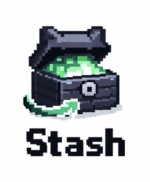
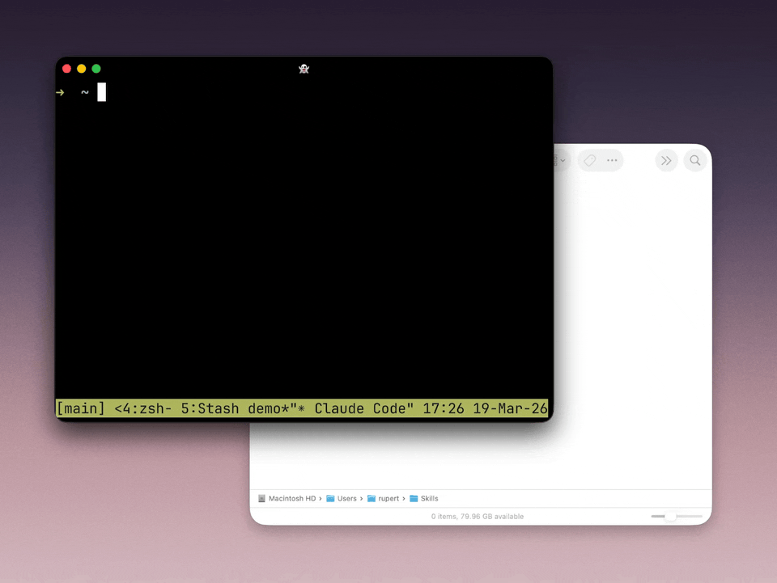

[](https://www.npmjs.com/package/@telepath-computer/stash)
[](LICENSE)

**Sync any folder anywhere, conflict-free.** Keep your agent memory, skills, and documents in sync across machines, agents, and collaborators — backed by a GitHub repo you already own. Changes appear in seconds.

[Read the launch post →](https://telepath.computer/blog/stash/)



## Quick Start

First, install Stash:

```bash
npm install -g @telepath-computer/stash
```

[Create a new repo on GitHub](https://github.com/new) to use for sync, then connect it:

```bash
stash connect ./dir-to-sync github:owner/repo
```

Or, from inside the folder:

```bash
cd dir-to-sync/
stash connect . github:owner/repo
```

If the path doesn't exist yet, `stash connect` creates it.

Follow the prompts to enter your repo & GitHub token (see below).

Then, start syncing!

```bash
stash start
```

> [!TIP]
> Run `stash start` once and forget about it — stash will keep all your stashes in sync in the background, even across restarts.

### Creating a GitHub token

1. Go to [github.com/settings/personal-access-tokens/new](https://github.com/settings/personal-access-tokens/new)
2. Give it a name (e.g. `stash`)
3. Under **Repository access**, select the repo(s) you want to use with stash
4. Under **Repository permissions**, set **Contents** to **Read and write**
5. Click **Generate token** and copy it

Alternatively, a classic token with the `repo` scope also works.

## How it works

A stash is a folder registered in `~/.stash/<id>/`, which stores its connection config and a snapshot of the last-synced file state. On each sync, Stash scans local files, fetches remote changes, and reconciles both sides using a version of Google's [diff-match-patch](https://github.com/google/diff-match-patch) algorithm (the same one used by Obsidian Sync). In background mode, this runs whenever a file changes or every 30 seconds.

1. Scan local files against the stored snapshot
2. Fetch remote changes from the provider
3. Reconcile — merge text edits, pick winners for binary files
4. Push remote-bound changes
5. Apply local-bound changes and save the new snapshot

- **Smart text merging.** Edits to different regions combine cleanly. Overlapping edits preserve both sides instead of silently dropping content.
- **Binary files** use last-modified-wins.
- **Automatic tracking.** Every file in the directory is synced except dotfiles, dot-directories, and symlinks.
- **Provider-agnostic.** GitHub is the built-in provider, but the transport layer is pluggable. See [docs/providers/overview.md](docs/providers/overview.md).

## Commands

| Command                           | Description                                                                |
| --------------------------------- | -------------------------------------------------------------------------- |
| `stash setup <provider>`          | Configure provider credentials                                             |
| `stash connect <path> <uri>`      | Connect a folder to a provider URI (creates the folder if missing)         |
| `stash disconnect <path> [<uri>]` | Disconnect a folder from a provider URI                                    |
| `stash relink <old> <new>`        | Move a stash to a new path (after renaming or moving the folder)           |
| `stash status`                    | Show background sync state and every registered stash                      |
| `stash start`                     | Install and start the background sync service                              |
| `stash stop`                      | Stop and uninstall the background sync service                             |

## Using stash with git

> [!WARNING]
> By default, stash refuses to sync a directory that contains `.git/`. Branch switches look like mass file edits to stash and can push destructive changes to the remote, and pushes that don't involve Stash snapshot updates will cause issues.

We recommend you avoid using `.git/` and Stash simultaneously. Stash is its own syncing service, and simply uses GitHub as a remote to store files.

*However*, you might really like git workflows, possess an insatiable rebellious streak, and still want to sync a stash with this tool and use git at the same time. If this is you, we recommend you **only use git locally**, and **disable background sync** (`stash stop`) while you switch branches.

Bypass the `.git/` check by passing `--dangerously-allow-git` at connect time:

```bash
stash connect ./my-repo github:owner/repo --dangerously-allow-git
```

Oh, and probably make a backup first. We'll be improving git compatibility in future, so expect this restriction to be relaxed.

## FAQ

**Will stash delete or overwrite my existing files?**

On first sync, Stash will nicely reconcile local and remote content with a merge. On subsequent syncs, anything deleted from the remote will be deleted locally, and vice-versa. Binary files are updated on a last-modified-wins basis, and so can also be overwritten.

**Does Stash work with structured data?**

Currently Stash will merge all text-like files (`json`, `yaml`, etc.) as text merges, meaning that structured data can't be guaranteed to be preserved in a valid form. We will add strict structured data parsing if this use case proves important (we expect it might, let us know).

**Can I use the same repo with both stash and git?**

Yes, sort of. Details and caveats are in [Using stash with git](#using-stash-with-git).

**Does stash keep a version history?**

Not yet locally. However, all Stash syncs appear as commits in GitHub, meaning you can recover the status of any previous successful sync from the repo.

**Who made this?**

The team at [Telepath](https://telepath.computer/). Read [the blog post](https://telepath.computer/blog/stash/) for our rationale.
